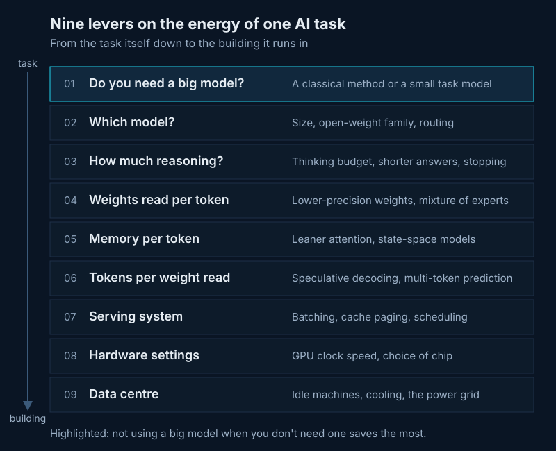

## In one line

AI wastes most of its energy when it runs, not when it trains, and mostly by moving data rather than doing maths. Start by asking whether you need an LLM at all, then work down the levers, counting joules instead of tokens.

## Key ideas

### Training laws miss the running cost

[Scaling laws](#scaling-laws), like DeepMind's [Chinchilla](https://arxiv.org/abs/2203.15556) work, describe how model size, data and compute trade off during training. Bacon pointed out that they say nothing about [inference](#inference), the cost of running a model for its whole life. Work by [Sardana and colleagues](https://arxiv.org/abs/2401.00448) extends the laws to include it.

### Moving data costs more than maths

On a GPU, fetching data from off-chip memory costs orders of magnitude more energy than an add or a multiply. Reading the prompt is limited by compute, but writing the answer one token at a time is limited by memory ([prefill and decode](#prefill-and-decode)). Long answers make it worse: every new token rereads the whole [KV cache](#kv-cache), so an answer twice as long costs roughly four times as much.

### Nine levers, from the task to the data centre

He broke the energy of one task into factors, each with its own lever:

```formula
E_task ≈ η × e_byte × N_call × N_tok × (b_w × P_act / (B × γ) + κ × L)
E_task: energy used to complete one task
η: data-centre overhead, such as cooling and idle machines
e_byte: energy to move one byte of data on the hardware
N_call: how many times a model is called for the task
N_tok: tokens generated per call
b_w: bytes per model weight (fewer with 8-bit or 4-bit weights)
P_act: parameters used for each token
B: batch size, how many requests share one read of the weights
γ: tokens produced per read of the weights
κ: bytes of KV cache stored per token
L: current length of the context
```


*Adapted from Pierre-Luc Bacon's talk at SMASH 2026.*

The first lever is the biggest: for scheduling or booking, a good old forecasting model often beats an LLM.

### Billed by the token, not the joule

Most published efficiency methods aim to save tokens, because tokens are what customers pay for. Energy can be measured on the GPU with off-the-shelf tools, but per-token billing gives customers little reason to care about joules. He called that a policy question.

### Measured properly, simple baselines win

Training [mixture-of-experts](#mixture-of-experts) models to switch experts less often looked promising, but measured at the hardware level it didn't pay off. The better answer was a classic caching rule from Belady: keep the experts you'll need soonest. He tested it on [OLMoE](https://arxiv.org/abs/2409.02060).

### Agents explore well but certify badly

AI agents are good at finding ideas but prone to false discoveries, often because they choose a test after peeking at the data. His group built a tool that separates choosing a test from running it, records every claim, and uses [e-values](#e-values) so results stay valid even when someone checks early. He sees making agents do trustworthy discovery as the flip side of AI safety.

## Worth reading

- [Beyond Chinchilla-Optimal: Accounting for Inference in Language Model Scaling Laws](https://arxiv.org/abs/2401.00448): Sardana et al., 2023. Adds the cost of running a model to scaling laws.
- [Training Compute-Optimal Large Language Models](https://arxiv.org/abs/2203.15556): Hoffmann et al. (DeepMind), 2022. The "Chinchilla" scaling laws.
- [OLMoE: Open Mixture-of-Experts Language Models](https://arxiv.org/abs/2409.02060): Muennighoff et al., 2024. The open model used in his caching results.
- A study of replacement algorithms for a virtual-storage computer: L. A. Belady, IBM Systems Journal, 1966. The classic rule: evict what you'll need furthest in the future.

## Terms

### Inference

Running a trained model to get an answer, as opposed to training it.

### Scaling laws

Formulas for how a model improves as you add parameters, data and compute.

### Prefill and decode

Prefill reads the whole prompt at once. Decode then writes the answer one token at a time, mostly waiting on memory.

### KV cache

Stored results for earlier tokens, so the model doesn't recompute them. It grows with every token.

### Mixture of experts

A model that only switches on a few of its sub-networks ("experts") for each token.

### E-values

A way of measuring statistical evidence that stays valid even if you check results early or stop at any time.
