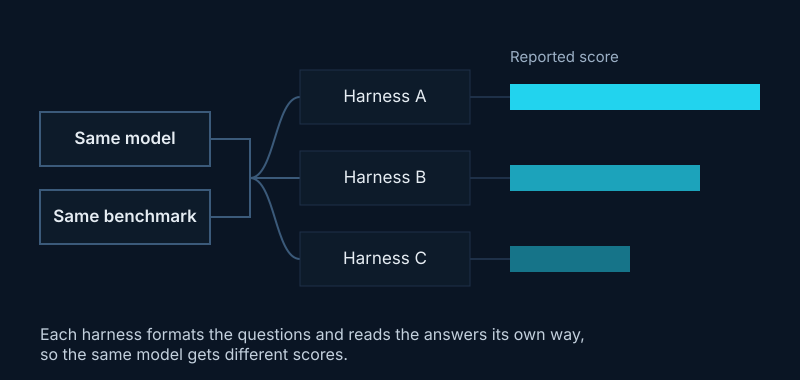

## In one line

A score only means something with the settings, source and definitions behind it. Make that context standard, borrow from fields that already measure carefully, and ask whose questions you're answering.

## Key ideas

### Same model, different numbers

She works on evaluation through the [EvalEval Coalition](https://evalevalai.com), a volunteer research network. Results are scattered across papers, model cards and blog posts, and most are reported by the developers themselves. The same model on the same benchmark can score about 15 points apart depending on the [evaluation harness](#evaluation-harness) that ran it. Even a standard metric like [perplexity](#perplexity) changes depending on whether you divide by tokens or by words.

*Illustration of a point made by Michelle Lin at SMASH 2026.*

### Every Eval Ever

A shared format and public store for evaluation results, so every score comes with what you need to interpret it: who reported it, which model, what settings and what the score means. Converters translate results from popular evaluation tools into one format, and the community reviews them. Once results share a format, you can see what's missing: most leave out the settings needed to reproduce them. See [the paper](https://arxiv.org/abs/2606.14516).

### Evaluation Cards

[Evaluation Cards](https://evaleval-general-eval-card.hf.space/about) turn those results into readable reports, with four checks per score: can it be rerun, is the benchmark documented, who reported it, and do independent reports agree? A plain-language mode serves policymakers. It doesn't rank developers; it makes the gaps visible.

### Embedded evaluators

Independent experts who work inside an AI lab with ongoing access, evaluating models during development rather than after release. It raises hard questions (who picks them, who pays them, what gets published), and clinical trials and the energy sector have used independent on-site monitors for decades.

### Her thesis: forests after wildfire

She predicts how Canada's boreal forests regrow after fire. Instead of one "recovery score", her model generates images of how an area will look as it recovers, so a land manager can judge recovery by what matters to them. Her lesson from working with geoscientists: you can't just feed climate data into a model as extra inputs; you have to understand the domain. [Geospatial foundation models](#geospatial-foundation-models) face the same evaluation problems, with stakes like floods and food, and their benchmarks may over-represent some parts of the world.

### Three takeaways

1. Measurement isn't new: medicine and science have done it carefully for a long time, so we don't need to start from scratch.
2. Interrogate your own measurements: what does the metric capture, and what does it leave out?
3. Think about who you're asking: domain experts, affected communities or developers. That shapes the answer you get.

## Worth reading

- [Every Eval Ever: A Unifying Schema and Community Repository for AI Evaluation Results](https://arxiv.org/abs/2606.14516): EvalEval Coalition, 2026.
- [Evaluation Cards](https://evaleval-general-eval-card.hf.space/about): readable reports on how far to trust each score.
- [EvalEval Coalition](https://evalevalai.com): the volunteer network behind both.

## Terms

### Evaluation harness

The software that runs a model on a test and scores it. Different harnesses format questions and read answers differently.

### Perplexity

How surprised a model is by real text; lower is better. The number depends on whether you average per token or per word.

### Geospatial foundation models

Large models trained on satellite and map data, then adapted to many tasks such as flood mapping or crop monitoring.
