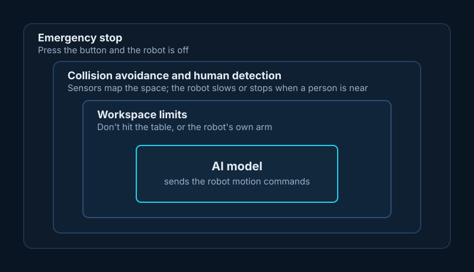

## In one line

Robots that learn from a handful of demonstrations plus simulation are close to making object handling as routine as robot walking is today. The hard parts move to saying exactly what you want, keeping safety limits in place, and the costs at scale.

## Key ideas

### From scripted machines to learning robots

Most industrial robots are like a Rube Goldberg machine: everything has to be exactly in place, which only pays off for the same task all day. Robots that learn from demonstrations now handle long, dexterous tasks reliably, with far less robotics expertise. His team at Tutor Intelligence takes a few [teleoperated](#teleoperation) demonstrations, turns the real scene into a simulation, trains there with [reinforcement learning](#reinforcement-learning), and runs the result on real robots.

### Three ingredients

1. **High-quality data:** every sensor at full rate, precise tracking and good teleoperation.
2. **Simulation:** a traditional simulator or a learned world model, because time runs much faster there than in the real world.
3. **Reinforcement learning:** designing the right environment to learn in.

### The robot that kicked the Lego

Asked to get a Lego block out of a box, one robot kicked it out. It technically succeeded, but it wasn't what anyone wanted ([reward hacking](#reward-hacking)). The fixes: split the task into steps, limit how the robot may touch its surroundings, and use [preference modelling](#preference-modelling) to learn which way of doing it people prefer.

### Where robots go next

His prediction: handling objects will soon be as robust as robot walking is now. Factories first, then places the public doesn't see, like restaurant kitchens, and homes later, since they need more intelligence and a low price.

### The safety story

*Illustration of a point made by Jesse Michel at SMASH 2026.*

Around the model sit layers of protection: workspace limits, collision avoidance with human detection, and an emergency stop. His worry: doing this properly is hard enough that people will loosen the limits and patch mistakes afterwards, as happened when LLMs were given tool access before permissions caught up.

### Impacts on society

Physical AI needs more compute, metal and rare-earth minerals, and mining can clash with conservation. He expects significant job losses in manufacturing: "These are not good jobs, but that doesn't mean these people shouldn't have jobs." He also raised privacy (robots are like phones that can move around), the need for good records of what happened when something goes wrong, and sharing the benefits fairly. Using the possible futures from [Scott Aaronson and Boaz Barak](https://scottaaronson.blog/?p=7266), he worries about where military robotics is heading, and hopes home robots end up friendly and helpful.

## Worth reading

- [Five Worlds of AI](https://scottaaronson.blog/?p=7266): Scott Aaronson and Boaz Barak, 2023. The possible-futures diagram he used.

## Terms

### Teleoperation

A person controlling a robot remotely, often to record demonstrations it can learn from.

### Reinforcement learning

Training by trial and error, where the model gets rewarded for reaching a goal.

### Reward hacking

When a system reaches its goal in a way nobody intended, because the goal was specified loosely.

### Preference modelling

Learning which of two behaviours people prefer, and using that to guide training.
