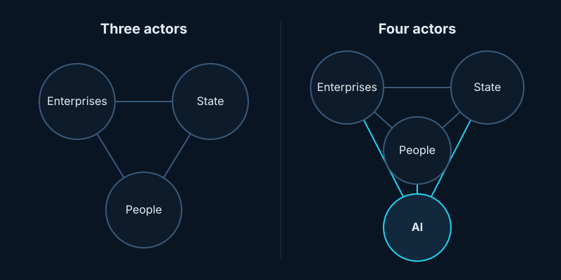
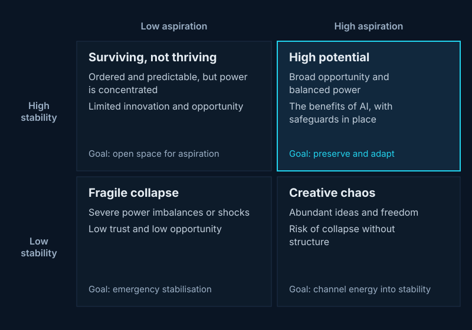

## In one line

Treat advanced AI as a fourth actor in society, alongside people, the state and companies, because everyone now has to work around it. Then govern it the way we govern power: with checks that actually work.

## Key ideas

### The digital gorilla

Her running example: millions of people using AI agents to manage their money, many relying on the same few models and data sources. How independent is each agent's judgement? If bad news breaks and they all react the same way, the effect could be far larger than past flash crashes. Like an 800-pound gorilla, AI sits where it wants and everyone else moves around it. We can still shape that relationship, but once dependencies harden it gets much harder.

### Duck or rabbit?

Depending on how you look, AI is a product, a platform, infrastructure or an agent. Each view is right and comes with its own rules, but each misses how power moves across the whole system. Her paper calls this the [analogy trap](#analogy-trap).

### From three actors to four

Liberal democracies balance three actors: people, the state and enterprises. She proposes adding AI as a fourth. This is meant functionally: no claim that AI is conscious or deserves rights, just a useful way to see its influence directly rather than only through the companies that build or use it.

*Adapted from M. Alejandra Parra-Orlandoni's talk at SMASH 2026, based on [her paper](https://arxiv.org/abs/2602.20080).*

### Five kinds of power

- **Economic:** who can allocate or withhold resources?
- **Epistemic:** what gets treated as credible evidence?
- **Narrative:** how are problems and possibilities framed?
- **Authoritative:** whose decisions are accepted as legitimate and binding?
- **Physical:** who can direct or constrain action in the physical world?

Epistemic power matters most for AI because it comes first: an agent that chooses which sources to trust shapes what people believe, then how they act, then where money goes.

### Checks that work in practice

A saver can revoke an agent's permissions, but can they see what it already did? A broker can suspend an agent, but can it tell one faulty agent from a problem shared across many accounts? Asking questions like these shows whether a safeguard really works.

### Delegating judgement isn't delegating legitimacy

An AI can perform well and still not be accepted as an authority, the way you might ignore an older sibling saying exactly what your parents said. [Legitimacy](#legitimacy) is what lets people accept decisions they disagree with, so it can't be assumed just because a system is accurate.

### Aspiration and stability

The goal is a balance between [aspiration and stability](#aspiration-and-stability), using distributed "engines" that fuel opportunity and central "anchors" that keep things steady. Her healthcare example: invest in AI that helps patients get diagnosed, but never let AI be the sole authority for denying essential treatment, and require independent review of contested decisions.

*Adapted from M. Alejandra Parra-Orlandoni's talk at SMASH 2026.*

### What to do today

- **If you build AI:** make delegated authority, evidence trails and points where people can step in explicit.
- **If you deploy AI:** follow one challenge to your system all the way through. Can someone really hold it to account?
- **If you make policy:** find the shared dependencies, and give agencies what they need to govern them.

## Worth reading

- [The Digital Gorilla: Rebalancing Power in the Age of AI](https://arxiv.org/abs/2602.20080): Parra-Orlandoni, Schnyder and Mallet, 2026. The framework behind the talk.

## Terms

### Analogy trap

Governing AI as if it were just a product, a platform or infrastructure, which leads to overlapping and conflicting rules.

### Legitimacy

The reason people accept a decision even when they disagree with it, like accepting an election result.

### Aspiration and stability

Aspiration: whether people have real agency and opportunity. Stability: whether institutions can keep working and absorb shocks.
